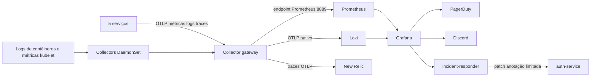

# ToggleMaster fase 4 — GitOps e observabilidade

Esta é uma cópia isolada da entrega anterior. Contém manifests, charts declarados por Applications do ArgoCD, configurações de telemetria, dashboard, alerta e o runbook de resposta. O código das aplicações, Terraform e CI fica em `../togglemaster`.

Repositórios públicos: [aplicação/IaC/CI](https://github.com/Marcelo6arcia/tech-challenge-fase-4) e [GitOps](https://github.com/Marcelo6arcia/togglemaster-gitops-fase-4). A configuração de promoção será habilitada após o bootstrap AWS. O CI da aplicação exige a variável `GITOPS_REPO` com o destino correto; não possui fallback para a fase 3.

## Estrutura e fluxo

```text
apps/                     cinco serviços; OTLP configurado por ambiente
argocd/applications/      cinco apps de negócio + plataforma + stack + runbook
observability/foundation namespace, StorageClass, ExternalSecrets e dashboard
observability/values/    versões/configurações dos charts
observability/dashboards fonte JSON do dashboard customizado
observability/responder  serviço webhook, PVC e RBAC do Self-Healing
tests/                   testes sintéticos do alerta usando o PromQL provisionado
```



Prometheus faz **somente um scrape**, no endpoint do gateway OTel. Métricas do cluster entram pelos receivers kubelet/cluster do Collector; não há um caminho paralelo dos exporters de infraestrutura direto para Prometheus.

Os cinco serviços enviam OTLP/HTTP para `http://otel-gateway.observability.svc.cluster.local:4318`. A porta 4317 também está disponível para OTLP/gRPC. Cada serviço tem `service.name` distinto e metadados de namespace, pod e ambiente.

Os agentes coletam `/var/log/pods/*/*/*.log` em todos os workers Linux, sem excluir namespaces ou os próprios Collectors. Logs do control plane gerenciado do EKS não são arquivos dos workers. Checkpoints ficam no node para evitar releitura após restart do agente. Os processos dos agentes leem logs como root, com capabilities removidas, filesystem raiz somente leitura e volumes de logs somente leitura; o namespace permite hostPath para essa finalidade.

SDKs exportam logs por OTLP e espelham JSON no stdout. Somente os espelhos com o booleano **`otel_exported: true`** são removidos pelo pipeline filelog. Logs de startup, Gunicorn, runtime e componentes do cluster permanecem coletados. Não há exporter de debug na stack, evitando realimentação dos logs do Collector. A marca representa encaminhamento pelo SDK, não confirmação de entrega no backend; indisponibilidades prolongadas ainda exigem verificar perdas/filas.

## Versões fixadas

| Componente | Chart | Aplicação |
|---|---|---|
| OpenTelemetry Collector | 0.178.2 | contrib 0.163.2 |
| Prometheus | 29.46.0 | 3.16.0 |
| Loki | 7.5.0 | 3.6.16 |
| Grafana | 10.5.14 | 12.3.1 |

As versões foram consultadas nos repositórios oficiais em 09/11/2026 e renderizadas com Helm. Charts e valores são referenciados por Applications com múltiplas fontes, suportadas pela base ArgoCD. A escolha de versões não substitui o scan de vulnerabilidades do pipeline.

## Preparação antes da sincronização

1. Publicar os dois repositórios nos destinos definidos e ajustar URLs, branch e `GITOPS_REPO` se os nomes mudarem. As imagens com tag `SET_BY_CI` precisam ser construídas e promovidas pelo pipeline antes de ficarem operacionais.
2. Revisar/aplicar a infraestrutura pelo fluxo Terraform autorizado. A fase 4 acrescenta EBS CSI com IRSA dedicado e política oficial V2; a StorageClass `gp3-observability` usa volumes criptografados e `WaitForFirstConsumer`.
3. Provisionar os valores externos no Secrets Manager. Terraform cria os nomes e gera a credencial do Grafana, mas não cria valores fictícios de APM ou incidentes.
4. Aplicar a camada `platform` para criar os AppProjects atualizados, depois permitir que o ArgoCD sincronize as Applications. Não instalar a stack com `helm install` nem contornar GitOps com apply manual.
5. Conferir PVCs `Bound`, ExternalSecrets `Ready`, todos os agentes nos workers e Applications `Synced/Healthy`. A falta de valores externos deixa os pods dependentes sem seus secrets; isso é pendência real, não ambiente pronto.

| Secret Kubernetes | Secret no Secrets Manager | Propriedades |
|---|---|---|
| `apm-credentials` | `togglemaster/dev/observability/apm` | `NEW_RELIC_LICENSE_KEY` |
| `incident-integrations` | `togglemaster/dev/observability/incidents` | `RESPONDER_TOKEN`, `PAGERDUTY_INTEGRATION_KEY`, `DISCORD_WEBHOOK_URL` |
| `grafana-admin` | `togglemaster/dev/observability/grafana` | `admin-user`, `admin-password` |

External Secrets recebe acesso somente aos ARNs explicitamente declarados no Terraform. Nenhum valor deve ser colocado nos YAMLs, no Git, em prints ou no vídeo.

A camada Terraform `platform` autentica os providers Kubernetes e Helm com `exec aws eks get-token`, renovando o token de curta duração em vez de salvá-lo no plano. Localmente, os scripts da aplicação exportam `AWS_PROFILE=fiap`; se usar Terraform diretamente, definir `TF_VAR_aws_profile=fiap` e conferir a identidade antes. No CI, manter `aws_profile=null`, para usar a sessão OIDC do runner. A CLI AWS precisa estar disponível onde o Terraform executar.

O gateway está configurado para o endpoint **US** do New Relic, `https://otlp.nr-data.net:4318`. Confirmar a região da conta; contas EU exigem o endpoint correspondente. Datadog também é permitido no enunciado, mas sua configuração não foi implementada nesta versão. APM e contas externas ainda precisam de validação real.

## Dashboard e alerta

O dashboard `togglemaster-fase4` reúne 13 painéis: CPU/memória dos nodes e pods, requisições por serviço, tráfego sem probes, latência p95, erros 5xx, processamento/erros do analytics, recebimento/falhas de exportação do Collector e logs com atualização de 5 segundos. Para streaming de logs, abrir também o Loki no Explore e ativar Live tail.

Analytics trabalha pela fila. Seu HTTP é health check; o volume de negócio aparece em mensagens processadas. Não interpretar probes como avaliações de flags. Os painéis de erro apresentam zero quando há telemetria saudável correspondente e o contador de erro ainda não foi criado.

O alerta `AuthHigh5xx` considera `/validate` do auth, **mais de 5% de respostas 5xx**, no mínimo **20 requisições na janela de 1 minuto**, por **30 segundos**. O grupo é avaliado a cada 10 segundos. A janela/volume são escolhas de demonstração, não números obrigatórios do enunciado.

Um contato reúne PagerDuty, Discord e o webhook interno do responder. Todos recebem o mesmo alerta, com `namespace=togglemaster` e `service=auth-service`. O nome `AuthHigh5xx` é contrato com a automação. Notificações resolvidas também são enviadas; o responder precisa tratá-las sem reiniciar novamente.

Somente a anotação `/spec/template/metadata/annotations/fiap.dev~1incident-restart` do deployment `auth-service` tem exceção de reconciliação, com `RespectIgnoreDifferences=true`. O `selfHeal` continua ligado. O runbook tem RBAC limitado para consultar/alterar esse deployment; isso não concede autorização para executar comandos arbitrários.

## Validações locais reproduzíveis

O workflow `.github/workflows/validate.yml` executa Kustomize, renderiza os cinco charts com as versões e arquivos de valores das próprias Applications e roda o teste do dashboard/alerta. Usa somente permissão de leitura do repositório; não recebe credenciais AWS ou Kubernetes e não acessa cluster. As dependências são Python/PyYAML, Helm, kubectl (apenas compilação local) e Docker no runner. Aprovação deste workflow não comprova funcionamento no EKS.

```bash
# Compila YAML/Kustomize localmente; não acessa a API Kubernetes.
for path in apps/overlays/dev/* platform observability/foundation observability/responder; do
  kubectl kustomize "$path" >/dev/null || exit 1
done

# Usa o PromQL realmente provisionado e um contêiner sem rede.
uv run --with pyyaml==6.0.3 python tests/validate-alert.py

# Exemplo de renderização de chart; não instala no cluster.
helm template otel-gateway opentelemetry-collector \
  --repo https://open-telemetry.github.io/opentelemetry-helm-charts \
  --version 0.178.2 --namespace observability \
  -f observability/values/otel-gateway.yaml
```

O JSON fonte em `observability/dashboards/togglemaster.json` e o conteúdo do ConfigMap devem permanecer iguais. O teste verifica essa igualdade. Após alterar o JSON, atualizar o ConfigMap correspondente antes de validar e commitar.

### Resultados verificados em 09/11/2026

- Renderização dos cinco charts e compilação dos cinco overlays, plataforma, foundation e responder: passaram.
- Configuração renderizada dos dois Collectors: aceita pelo binário real 0.163.2, sem rede, com arquivos de ServiceAccount fictícios.
- Filtro filelog: três linhas CRI sintéticas entraram; stdout normal e runtime permaneceram, somente o espelho SDK foi removido.
- Prometheus: `promtool check config` passou. Quatro testes do alerta passaram: sem telemetria, baixo volume, menos de 5% e erro sustentado com volume suficiente.
- Loki: `-verify-config=true` passou com a configuração renderizada.
- Grafana 12.3.1: provisionou datasources, dashboard, regra e os três contatos; API `/api/health` retornou banco `ok`. Teste isolado, sem rede, credenciais fictícias e regra pausada somente na cópia de teste; não houve notificação externa.
- Terraform `fmt` e `validate` passaram nas camadas `infra` e `platform`, usando inicialização sem backend. Isso não é um plan nem um apply.

**Ainda não comprovado por estes testes:** operação no EKS, PVCs e coleta kubelet reais, cobertura dos logs de todos os workers, ingestão/mapa no APM, abertura de incidente e recebimento no Discord, ou restart automático no cluster. Essas evidências são necessárias antes de liberar o pacote para gravação.

## Acesso e persistência

Grafana, Prometheus e Loki ficam em Services internos. Após confirmar o contexto acadêmico, usar `kubectl --context togglemaster-fase4 -n observability port-forward svc/grafana 3000:80` e obter a credencial pelos canais seguros da equipe. Não filmar a obtenção dos secrets.

Prometheus e Loki têm 10 GiB cada, Grafana 2 GiB; a retenção de métricas/logs é 7 dias. Os PVCs usam EBS e a classe tem reclaim policy `Retain`: excluir o cluster ou um PVC não garante apagar os volumes. Planejar a limpeza autorizada após preservar as evidências. O gateway possui uma réplica para evitar scrapes distribuídos inconsistentes; a configuração é acadêmica, não uma alegação de alta disponibilidade.

## Referências de implementação

- [Chart oficial do OpenTelemetry](https://opentelemetry.io/docs/platforms/kubernetes/helm/collector/)
- [Ingestão OTLP nativa no Loki](https://grafana.com/docs/loki/latest/send-data/otel/)
- [Provisionamento de alertas Grafana](https://grafana.com/docs/grafana/latest/alerting/set-up/provision-alerting-resources/file-provisioning/)
- [OTLP no New Relic](https://docs.newrelic.com/docs/opentelemetry/best-practices/opentelemetry-otlp/)
- [EBS CSI no EKS](https://docs.aws.amazon.com/eks/latest/userguide/ebs-csi.html)
